# 📱 Mobil Programlama (Flutter) — Sınav Çalışma Rehberi

> Dr. Öğr. Üyesi Hasan DEMİR — Mobil Programlama ders sunumları (2_2, 3_1, 4_1, 5_1, 6_1yeni, 7_1) temel alınarak, NotebookLM "flutter sınav" defterine sorular sorularak hazırlanmıştır.

---

## 🎯 Sınav Formatı (hocanın notları)

| Bilgi | Ne anlama geliyor? |
|---|---|
| **1–2 test, gerisi klasik** | Ağırlık kod yazma sorularında. Testler büyük ihtimalle kavram sorusu (Stateless/Stateful farkı, `setState`, `push`/`pop` vb.). |
| **Kod çıktısı olabilir, kesin değil** | Verilen kodun ekranda ne göstereceğini sorabilir → [§9 Kod Çıktısı Soruları](#9--kod-çıktısı-soruları-ekranda-ne-görünür) |
| **Bir problem verilir, kodunu yaz** | Asıl soru tipi bu → [§8 Örnek Sınav Soruları ve Çözümleri](#8--örnek-sınav-soruları-problem--kod) |
| **Syntax çok önemli değil** | Virgül/parantez eksikliği puan kırdırmaz; **mantık ve doğru widget seçimi** önemli. |
| **Import satırına gerek yok** | `import 'package:flutter/material.dart';` yazmak zorunlu değil. |
| **Widget adı önemliyse yazılmalı** | `Navigator`, `MaterialPageRoute`, `ListView.builder`, `Checkbox`, `setState` gibi isimler **doğru** yazılmalı. |
| **Navigator, custom(er), model** | Kesin çıkacak konular → [§5 Navigator](#5--navigator--sayfalar-arası-geçiş), [§6 Custom Widget](#6--custom-widget-özel-widget), [§7 Model](#7--model-sınıfı--enum) |

> **"customer" hakkında not:** NotebookLM'e sorulduğunda kaynakların **hiçbirinde "customer" kelimesi geçmiyor**. "custom" ise **Custom Widget** (TodoItem) bağlamında geçiyor. Yani büyük ihtimalle hoca **"custom widget"** dedi. Yine de garanti olsun diye [§8 Soru 6](#soru-6--müşteri-customer-listesi--model--custom-widget--navigator)'da `Customer` modeli ile tüm konuları birleştiren bir örnek de var.

---

## 📚 İçindekiler

1. [Konu Haritası](#1--konu-haritası-hangi-sunumda-ne-var)
2. [Temel Yapı: MaterialApp, Scaffold, Stateless / Stateful](#2--temel-yapı)
3. [setState ve Durum Yönetimi](#3--setstate-ve-durum-yönetimi)
4. [Layout Widget'ları (Container, Padding, Row, Column, Expanded…)](#4--layout-widgetları)
5. [**Navigator — Sayfalar Arası Geçiş**](#5--navigator--sayfalar-arası-geçiş)
6. [**Custom Widget (Özel Widget)**](#6--custom-widget-özel-widget)
7. [**Model Sınıfı + Enum**](#7--model-sınıfı--enum)
8. [**Örnek Sınav Soruları (Problem → Kod)**](#8--örnek-sınav-soruları-problem--kod)
9. [Kod Çıktısı Soruları](#9--kod-çıktısı-soruları-ekranda-ne-görünür)
10. [Sık Yapılan Hatalar](#10--sık-yapılan-hatalar)
11. [Test Soruları İçin Hızlı Tekrar](#11--test-soruları-için-hızlı-tekrar)
12. [Son Dakika Kopya Kağıdı](#12--son-dakika-kopya-kağıdı)

---

## 1 · Konu Haritası (hangi sunumda ne var?)

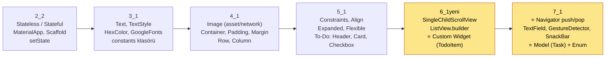

| Sunum | Ana Konular | Anlatılan Widget'lar | Uygulamalar |
|---|---|---|---|
| **2_2** | StatelessWidget, MaterialApp, Scaffold, StatefulWidget, `setState()` | MaterialApp, Scaffold, AppBar, Text, Center, Column, FloatingActionButton, ElevatedButton, Container | Kişisel bilgi ekranı · Sayaç · İki sayının toplamı |
| **3_1** | TextStyle, pub.dev paketleri, `constants` klasörü, font ekleme, tema | Text, TextStyle, ThemeData, HexColor, GoogleFonts | GoogleFonts + HexColor uygulaması |
| **4_1** | Resim ekleme (asset/online), layout, padding/margin, Row/Column hizalama | Image, AssetImage, NetworkImage, Container, Padding, Row, Column | Resimli container · Row ile 3 metin · Column+Row kombinasyonu |
| **5_1** | "Constraints go down, sizes go up", Align, UnconstrainedBox, Expanded/Flexible, Figma, To-Do tasarımı | Align, Center, UnconstrainedBox, Expanded, Flexible, SafeArea, BoxDecoration, Card, Icon, Checkbox | To-Do header + Card + Checkbox |
| **6_1yeni** | Card yuvarlatma, SingleChildScrollView, **ListView.builder**, **Custom Widget** | Card, SingleChildScrollView, ListView.builder, Align, TodoItem | ListView örneği (ornek.dart) · Modüler To-Do listesi |
| **7_1** | Dosya yapısı (screens/model/constants), **Navigator**, form elemanları, **Task modeli + enum** | Navigator, MaterialPageRoute, IconButton, TextField, InputDecoration, SizedBox, GestureDetector, SnackBar | Çok sayfalı To-Do uygulaması |

### Derste yapılan To-Do uygulamasının hedef tasarımı (Figma)

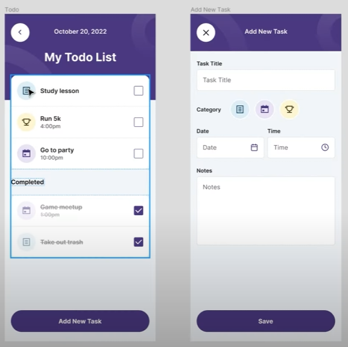

*Solda ana sayfa (HomeScreen), sağda "Add New Task" butonuna basınca `Navigator.push` ile açılan sayfa (AddNewTaskScreen).*

### Proje klasör yapısı (7_1'de oluşturulan)

```
lib/
├── main.dart                 → runApp(...), home: HomeScreen()
├── todoitem.dart             → ⭐ Custom widget (TodoItem)
├── screens/
│   ├── home.dart             → ⭐ HomeScreen (Navigator.push burada)
│   └── add_new_task.dart     → ⭐ AddNewTaskScreen (Navigator.pop burada)
├── model/
│   └── task.dart             → ⭐ Task model sınıfı
├── constants/
│   ├── color.dart            → const String backgroundcolor = "#...";
│   └── tasktype.dart         → ⭐ enum TaskType { note, calendar, contest }
└── assets/
    ├── images/               → header.png, add_new_task_header.png, category_1.png …
    └── fonts/
```

---

## 2 · Temel Yapı

### 2.1 Her Flutter uygulamasının iskeleti

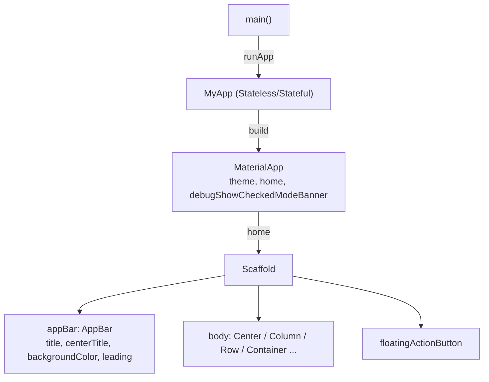

```dart
void main() {
  runApp(const Wigdetay());
}

class Wigdetay extends StatelessWidget {
  const Wigdetay({super.key});

  @override
  Widget build(BuildContext context) {
    return MaterialApp(
      home: Scaffold(
        appBar: AppBar(
          title: const Text("Merhaba"),
          centerTitle: true,                 // başlığı ortala (bool)
          backgroundColor: Colors.deepOrange,// AppBar rengi
          leading: const Text("Menu"),       // title'dan ÖNCE (solda) gelir
        ),
        body: const Center(child: Text("hello")),  // beyaz alanı kullanmak için body
        floatingActionButton: FloatingActionButton(
          child: const Text("+"),
          onPressed: () {},
        ),
      ),
    );
  }
}
```

**Akılda tut:**
- Widget isimleri **Büyük** harfle (`Container`), property isimleri **küçük + camelCase** (`backgroundColor`).
- `MaterialApp` olmadan `Text` vb. düzgün görünmez (boş/siyah ekran).
- Değişken içermeyen widget'lar `const` olabilir.

### 2.2 StatelessWidget vs StatefulWidget

| | **StatelessWidget** | **StatefulWidget** |
|---|---|---|
| Durum (state) | Yok, sabit | Var, değişebilir |
| Yeniden çizilme | Kullanıcı etkileşimiyle değişmez | `setState()` ile yeniden `build` edilir |
| Sınıf sayısı | 1 sınıf | **2 sınıf**: Widget + `State` sınıfı |
| Örnek | Sabit metin, ikon, statik liste | Sayaç, form, checkbox, değişen liste |
| `build` nerede? | Widget sınıfında | **State** sınıfında |

```dart
class Test extends StatefulWidget {
  const Test({super.key});

  @override
  State<Test> createState() => _TestState();   // State nesnesini oluşturur
}

class _TestState extends State<Test> {
  // ⚠️ Değişkenler BURAYA (build'in dışına)
  @override
  Widget build(BuildContext context) {
    return Container();
  }
}
```

> VS Code kısayolu: Stateless widget'ın adına gel → **Ctrl+Shift+R** (veya Ctrl+.) → *Convert to StatefulWidget*. Bir widget'ı başka widget'ın içine almak için de aynı menüden *Wrap with widget / Center / Padding*.

---

## 3 · setState ve Durum Yönetimi

`setState()` → durumu değiştirir **ve** Flutter'a "ekranı yeniden çiz (build)" der.

```mermaid
sequenceDiagram
    participant K as Kullanıcı
    participant B as ElevatedButton
    participant S as State (_TestState)
    participant E as Ekran
    K->>B: tıklar
    B->>S: onPressed()
    S->>S: setState(() { val = val + 1; })
    S->>E: build() yeniden çalışır
    E-->>K: yeni değer görünür
```

```dart
class _TestState extends State<Test> {
  int val = 0;                       // değişkenimiz (build dışında!)

  @override
  Widget build(BuildContext context) {
    return MaterialApp(
      home: Scaffold(
        body: Center(
          child: Column(
            mainAxisAlignment: MainAxisAlignment.center,
            children: [
              Text(val.toString()),    // Text sadece String alır → toString()
              ElevatedButton(
                onPressed: () {
                  setState(() {
                    val = val + 1;     // setState OLMADAN değer artar ama ekran değişmez!
                  });
                },
                child: const Text("tıklayın"),
              ),
            ],
          ),
        ),
      ),
    );
  }
}
```

| Kod | Sonuç |
|---|---|
| `onPressed: () { val = val + 1; print(val); }` | Konsolda değer artar, **ekranda hep 0** görünür. |
| `onPressed: () { setState(() { val = val + 1; }); }` | Ekrandaki değer **artar**. |

---

## 4 · Layout Widget'ları

### 4.1 Container, Padding, Margin

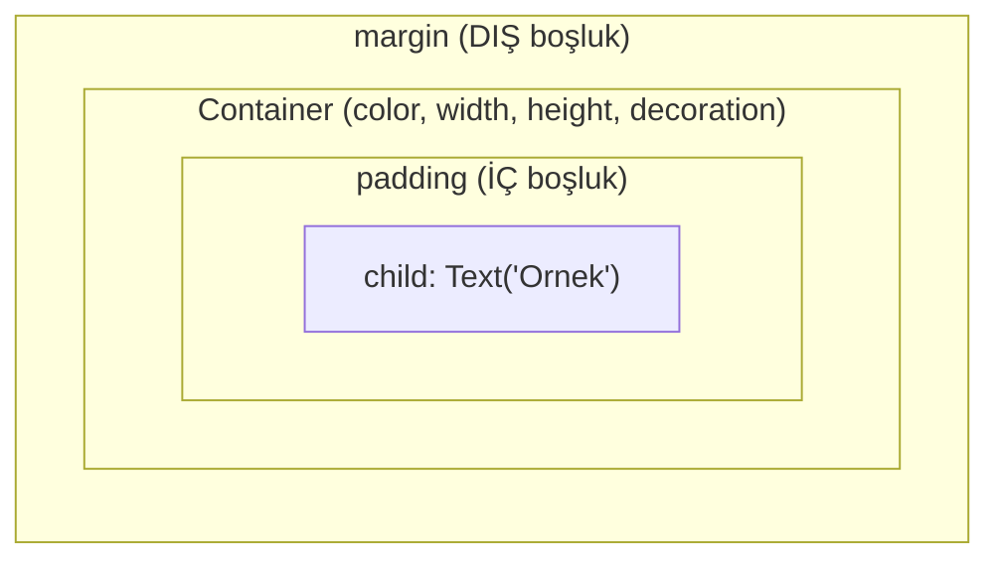

```dart
Container(
  margin: const EdgeInsets.all(20.0),          // dış boşluk
  padding: const EdgeInsets.all(20.0),         // iç boşluk
  color: Colors.amberAccent,
  child: const Text("Ornek"),
)
```

| EdgeInsets | Anlamı |
|---|---|
| `EdgeInsets.all(20)` | 4 kenar 20 |
| `EdgeInsets.only(left: 20, top: 10)` | sadece belirtilen kenarlar |
| `EdgeInsets.fromLTRB(40, 5, 20, 10)` | Sol, Üst, Sağ, Alt |
| `EdgeInsets.symmetric(vertical: 20, horizontal: 40)` | dikey / yatay simetrik |

> `color` ve `decoration` **aynı anda** Container'da kullanılamaz; decoration varsa rengi `BoxDecoration(color: ...)` içine yaz.

### 4.2 Row ve Column

| | **Row** (yatay) | **Column** (dikey) |
|---|---|---|
| `mainAxisAlignment` | yatay hizalama | dikey hizalama |
| `crossAxisAlignment` | dikey hizalama | yatay hizalama |
| `children: [ ... ]` | yan yana | alt alta |

Değerler: `MainAxisAlignment.center / start / end / spaceBetween / spaceAround / spaceEvenly` · `CrossAxisAlignment.start / end / center / stretch / baseline`

```dart
body: Center(
  child: Column(
    mainAxisAlignment: MainAxisAlignment.center,
    children: [
      const Text('Dikey Düzen: 1. Satır', style: TextStyle(fontSize: 20)),
      const Text('Dikey Düzen: 2. Satır', style: TextStyle(fontSize: 25)),
      Row(
        mainAxisAlignment: MainAxisAlignment.center,
        children: const [
          Text('Yatay Düzen: 1', style: TextStyle(fontSize: 15)),
          Text('Yatay Düzen: 2', style: TextStyle(fontSize: 30)),
        ],
      ),
    ],
  ),
),
```

### 4.3 Constraints, Align, Expanded, Flexible (5_1)

> **"Constraints go down, sizes go up, parent sets position."**
> Ebeveyn → çocuğa min/max kısıt gönderir · Çocuk → boyutunu belirleyip yukarı bildirir · Ebeveyn → konumu belirler.

| Widget | Ne işe yarar? |
|---|---|
| `Center` | Çocuğu ortalar; çocuğa kendi boyutunu kullanma serbestliği verir. |
| `Align(alignment: Alignment.bottomCenter, ...)` | Çocuğu istenen noktaya hizalar (`topLeft`, `centerLeft`, `bottomCenter`…). |
| `UnconstrainedBox` | Çocuğu ebeveyn kısıtlarından kurtarır (taşma riski!). |
| `Expanded` | Row/Column'daki **kalan alanı** kaplar; overflow'u önler. |
| `Flexible(flex: 2, ...)` | Esnek alan; `flex` ile oran verilir. |
| `SafeArea` | Bildirim çubuğu ve alttaki tuşların altına taşmayı önler. |
| `MediaQuery.of(context).size.width / .height` | Ekran genişliği / yüksekliği (double). |

```dart
// ❌ Overflow hatası (uzun metin ekrana sığmaz)
Row(children: [
  Container(color: Colors.red, child: Text("helloasdasfasfasfd...")),
  Container(color: Colors.white, child: Text("world")),
])

// ✅ Expanded ile çözüm
Row(children: [
  Expanded(child: Container(color: Colors.red, child: Text("helloasdasfasfasfd..."))),
  Expanded(child: Container(color: Colors.white, child: Text("world"))),
])
```

### 4.4 Resim, Font, Renk (3_1 & 4_1)

```yaml
# pubspec.yaml
flutter:
  assets:
    - lib/assets/images/          # klasördeki tüm resimler
  fonts:
    - family: deneme
      fonts:
        - asset: lib/assets/fonts/Schyler-Regular.ttf
        - asset: lib/assets/fonts/Schyler-Italic.ttf
          style: italic
```

```dart
Image.asset("lib/assets/images/img1.jpg")              // = Image(image: AssetImage(...))
Image.network("https://.../resim.png")                  // = Image(image: NetworkImage(...))

Container(                                              // Container'a arka plan resmi
  decoration: const BoxDecoration(
    image: DecorationImage(
      image: AssetImage("lib/assets/images/header.png"),
      fit: BoxFit.cover,                                // tüm alanı kapla
    ),
  ),
)

Text("Hasan Demir", style: GoogleFonts.roboto(fontSize: 50, color: HexColor("00913A")))
MaterialApp(theme: ThemeData(textTheme: GoogleFonts.robotoTextTheme()))   // tüm proje fontu
```

- Paket ekleme: terminale `flutter pub add hexcolor` (veya pubspec `dependencies:` altına `google_fonts: ^6.2.1`).
- Sabitler: `lib/constants/colors.dart` → `const String primaryColor = "#525FE1";`
- Debug etiketini kaldırma: `MaterialApp(debugShowCheckedModeBanner: false, ...)`

---

## 5 · Navigator — Sayfalar Arası Geçiş

> ⭐ **Sınavda kesin.** `Navigator`, sayfaları bir **yığın (stack)** gibi yönetir.

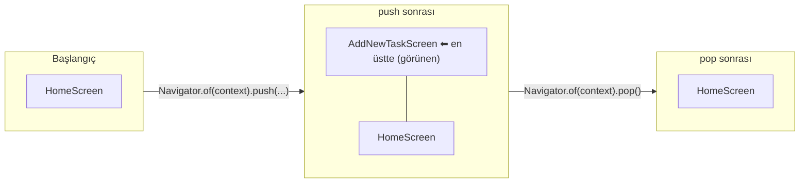

| Metot | Ne yapar? |
|---|---|
| `Navigator.of(context).push(MaterialPageRoute(builder: (context) => const YeniSayfa()))` | Yığının **üstüne** yeni sayfa ekler → yeni sayfa açılır. |
| `Navigator.of(context).pop()` | Yığının en üstündeki sayfayı **çıkarır** → önceki sayfaya dönülür. |
| `MaterialPageRoute` | Sayfa geçiş rotasını (animasyonlu) oluşturur. |
| `builder: (context) => ...` | Açılacak sayfa widget'ını döndüren fonksiyon (tek return olduğu için **arrow function**). |

### 5.1 Adım adım (7_1)

**1) Butona Navigator ekle** — önce boş iskelet:

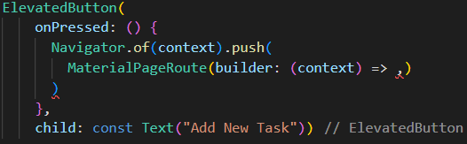

**2) builder'a açılacak sayfayı ver:**

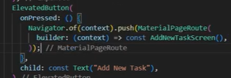

**3) Yeni sayfada geri dönüş:**
- Yeni sayfada **`AppBar` varsa geri tuşu (←) otomatik gelir** ve basınca `pop` yapar.
- AppBar yoksa (derste header Container ile yapıldı) `IconButton` + `Navigator.of(context).pop()` kullanılır:

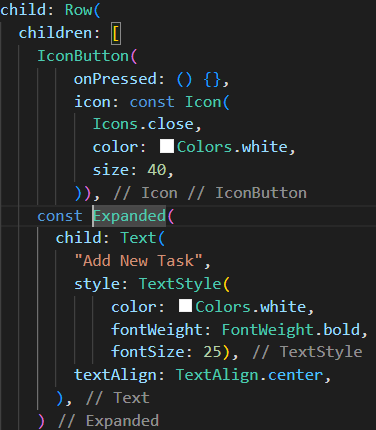

### 5.2 `lib/screens/home.dart` — push tarafı (özet)

```dart
class HomeScreen extends StatefulWidget {
  const HomeScreen({super.key});

  @override
  State<HomeScreen> createState() => _HomeScreenState();
}

class _HomeScreenState extends State<HomeScreen> {
  @override
  Widget build(BuildContext context) {
    double devicewidth = MediaQuery.of(context).size.width;
    double deviceheight = MediaQuery.of(context).size.height;

    return SafeArea(
      child: Scaffold(
        body: Column(
          children: [
            // ... header, listeler ...
            ElevatedButton(
              onPressed: () {
                Navigator.of(context).push(
                  MaterialPageRoute(
                    builder: (context) => const AddNewTaskScreen(),   // ⭐
                  ),
                );
              },
              child: const Text("Add New Task"),
            ),
          ],
        ),
      ),
    );
  }
}
```

`main.dart`:

```dart
void main() => runApp(const MyApp());

class MyApp extends StatelessWidget {
  const MyApp({super.key});
  @override
  Widget build(BuildContext context) {
    return const MaterialApp(
      debugShowCheckedModeBanner: false,
      home: HomeScreen(),          // uygulama HomeScreen ile açılır
    );
  }
}
```

### 5.3 `lib/screens/add_new_task.dart` — pop tarafı ve form elemanları

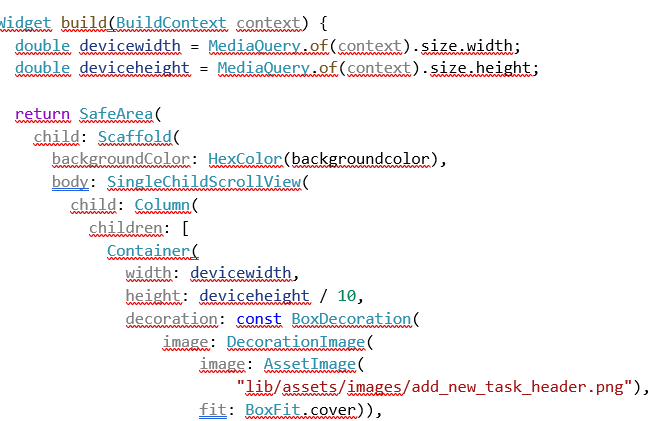

```dart
class AddNewTaskScreen extends StatelessWidget {
  const AddNewTaskScreen({super.key});

  @override
  Widget build(BuildContext context) {
    double devicewidth = MediaQuery.of(context).size.width;
    double deviceheight = MediaQuery.of(context).size.height;

    return SafeArea(
      child: Scaffold(
        backgroundColor: HexColor(backgroundcolor),
        body: SingleChildScrollView(            // klavye açılınca taşmasın diye
          child: Column(
            children: [
              // --- Header ---
              Container(
                width: devicewidth,
                height: deviceheight / 10,
                decoration: const BoxDecoration(
                  image: DecorationImage(
                    image: AssetImage("lib/assets/images/add_new_task_header.png"),
                    fit: BoxFit.cover,
                  ),
                ),
                child: Row(
                  children: [
                    IconButton(
                      onPressed: () {
                        Navigator.of(context).pop();     // ⭐ önceki sayfaya dön
                      },
                      icon: const Icon(Icons.close, color: Colors.white, size: 40),
                    ),
                    const Expanded(
                      child: Text(
                        "Add New Task",
                        textAlign: TextAlign.center,
                        style: TextStyle(color: Colors.white, fontWeight: FontWeight.bold, fontSize: 25),
                      ),
                    ),
                  ],
                ),
              ),

              // --- Task Title ---
              const Padding(padding: EdgeInsets.only(top: 10), child: Text("Task Title")),
              const Padding(
                padding: EdgeInsets.symmetric(horizontal: 20),
                child: TextField(
                  decoration: InputDecoration(filled: true, fillColor: Colors.white),
                ),
              ),

              // --- Category (GestureDetector + SnackBar) ---
              Row(
                children: [
                  const Text("Category"),
                  GestureDetector(
                    onTap: () {
                      ScaffoldMessenger.of(context).showSnackBar(
                        const SnackBar(
                          duration: Duration(milliseconds: 300),
                          content: Text("Category secildi."),
                        ),
                      );
                    },
                    child: Image.asset("lib/assets/images/category_1.png"),
                  ),
                ],
              ),

              // --- Date / Time (yan yana iki sütun) ---
              Row(
                children: [
                  Expanded(child: Column(children: [const Text("Date"), TextField()])),
                  Expanded(child: Column(children: [const Text("Time"), TextField()])),
                ],
              ),

              // --- Notes (çok satırlı) ---
              const Text("Notes"),
              const SizedBox(
                height: 300,
                child: TextField(
                  expands: true,
                  maxLines: null,
                  decoration: InputDecoration(filled: true, fillColor: Colors.white, isDense: true),
                ),
              ),

              // --- Save ---
              ElevatedButton(onPressed: () {}, child: const Text("SAVE")),
            ],
          ),
        ),
      ),
    );
  }
}
```

| Slayttaki parça | Görsel |
|---|---|
| GestureDetector + SnackBar | 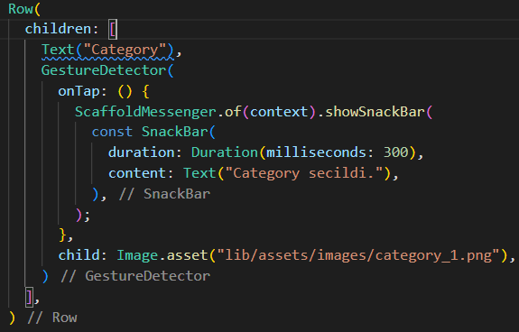 |
| Row içinde iki Expanded Column (Date/Time) | 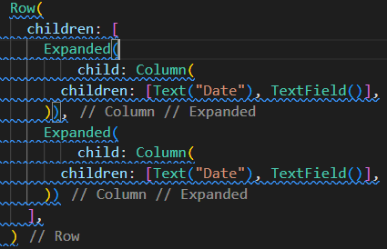 |
| SizedBox içinde çok satırlı TextField (Notes) | 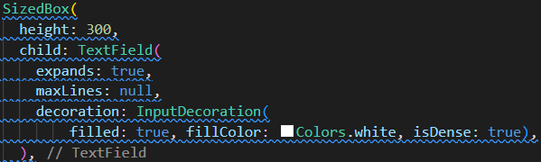 |

### 5.4 Bonus: Sayfaya veri göndermek (constructor ile)

Sunumlarda doğrudan yok ama "Navigator + model" sorusu bunu isteyebilir. Mantık **custom widget'a parametre vermekle aynı**:

```dart
// Gönderen sayfa
Navigator.of(context).push(
  MaterialPageRoute(builder: (context) => DetaySayfasi(task: todo[index])),
);

// Alan sayfa
class DetaySayfasi extends StatelessWidget {
  const DetaySayfasi({super.key, required this.task});
  final Task task;

  @override
  Widget build(BuildContext context) {
    return Scaffold(
      appBar: AppBar(title: Text(task.title)),   // AppBar → geri tuşu otomatik
      body: Center(child: Text(task.description)),
    );
  }
}
```

> 💡 **Stateless** sayfada alan doğrudan `task.title`; **Stateful** sayfada State sınıfı içinden `widget.task.title` yazılır.

---

## 6 · Custom Widget (Özel Widget)

> ⭐ **Neden?** Aynı Card kodu defalarca tekrar ediyordu → tek bir widget'a (TodoItem) taşındı, değişen kısım (başlık) **parametre** olarak dışarıdan verildi.

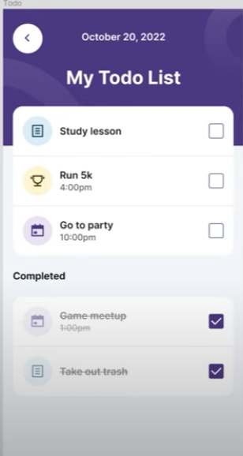

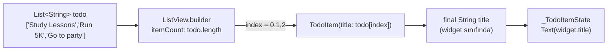

### 6.1 Custom widget'ın 4 kuralı

| # | Kural | Kod |
|---|---|---|
| 1 | Ayrı dosya + StatefulWidget/StatelessWidget | `lib/todoitem.dart` → `class TodoItem extends StatefulWidget` |
| 2 | Dışarıdan gelen veri **final** alan | `final String title;` |
| 3 | Constructor'da **required** parametre | `const TodoItem({super.key, required this.title});` |
| 4 | State sınıfından erişim **widget.** ile | `Text(widget.title)` |

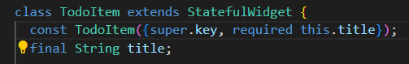

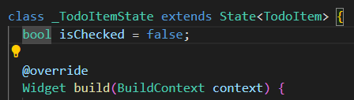

### 6.2 `lib/todoitem.dart` — tam kod

```dart
class TodoItem extends StatefulWidget {
  const TodoItem({super.key, required this.title});   // dışarıdan zorunlu parametre
  final String title;                                 // değişmez (sadece gösterilecek)

  @override
  State<TodoItem> createState() => _TodoItemState();
}

class _TodoItemState extends State<TodoItem> {
  bool isChecked = false;                             // her kartın kendi durumu

  @override
  Widget build(BuildContext context) {
    return Card(
      shape: RoundedRectangleBorder(borderRadius: BorderRadius.circular(20)),  // köşeleri yumuşat
      child: Padding(
        padding: const EdgeInsets.all(20),
        child: Row(
          mainAxisAlignment: MainAxisAlignment.spaceBetween,
          children: [
            const Icon(Icons.note_outlined, size: 50),
            Text(
              widget.title,                           // ⭐ widget.title
              style: const TextStyle(fontWeight: FontWeight.bold, fontSize: 21),
            ),
            Checkbox(
              value: isChecked,
              onChanged: (val) {
                setState(() {
                  isChecked = val!;                   // val bool? → ! ile null değil de
                });
              },
            ),
          ],
        ),
      ),
    );
  }
}
```

### 6.3 ListView.builder ile kullanmak

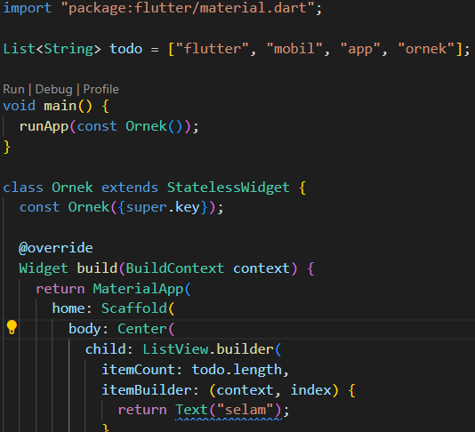

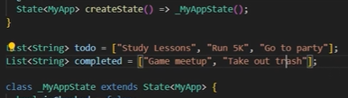

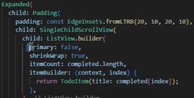

```dart
List<String> todo = ["Study Lessons", "Run 5K", "Go to party"];
List<String> completed = ["Game meetup", "Take out trash"];

// ...
Expanded(
  child: Padding(
    padding: const EdgeInsets.fromLTRB(20, 10, 20, 10),
    child: SingleChildScrollView(
      child: ListView.builder(
        primary: false,            // kaydırmayı dıştaki SingleChildScrollView yapsın
        shrinkWrap: true,          // liste sadece içeriği kadar yer kaplasın
        itemCount: todo.length,    // kaç eleman?
        itemBuilder: (context, index) {
          return TodoItem(title: todo[index]);   // ⭐ her eleman için custom widget
        },
      ),
    ),
  ),
),
```

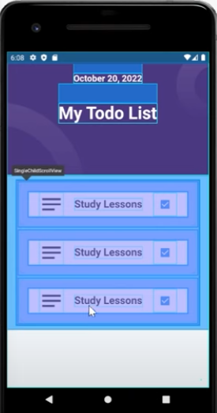

*SingleChildScrollView'ın kapladığı alan (mavi). Alttaki boşluğu da kapsaması için parent `Padding` → `Expanded` içine alındı.*

| ListView türü | Kullanım |
|---|---|
| `ListView(children: [...])` | Küçük, sabit liste |
| `ListView.builder(itemCount, itemBuilder)` | ⭐ Dinamik liste (en çok kullanılan) |
| `ListView.separated` | Elemanlar arası ayırıcı (çizgi/boşluk) |
| `ListView.custom` | Tam özelleştirme |

---

## 7 · Model Sınıfı + Enum

> ⭐ `List<String>` yerine **nesne** tutulur → her görevin başlığı, açıklaması, durumu ve tipi bir arada olur. ("Artık card'larımız birer model haline gelecek.")

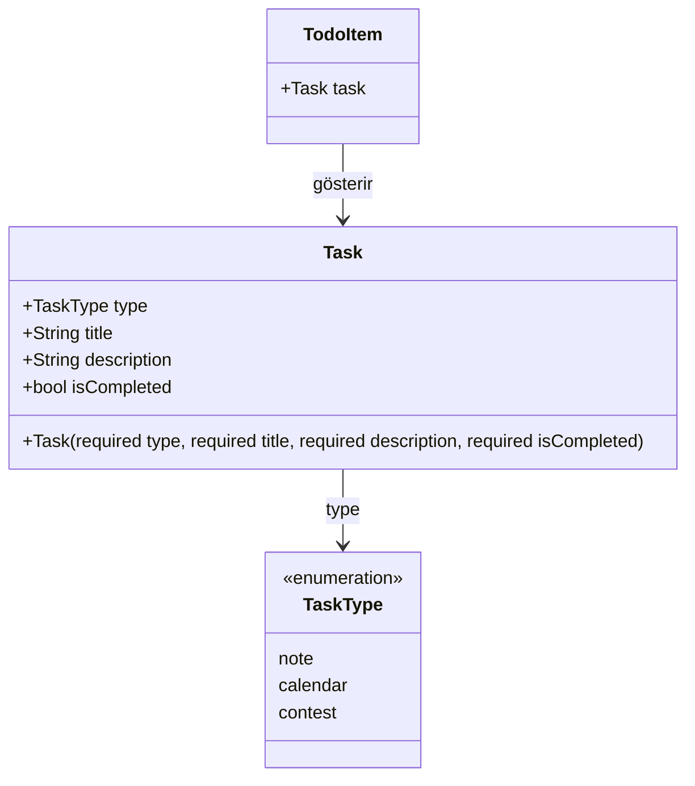

### 7.1 İlk hali → `type` eklenmiş hali

| İlk Task modeli | TaskType eklenmiş hali |
|---|---|
| 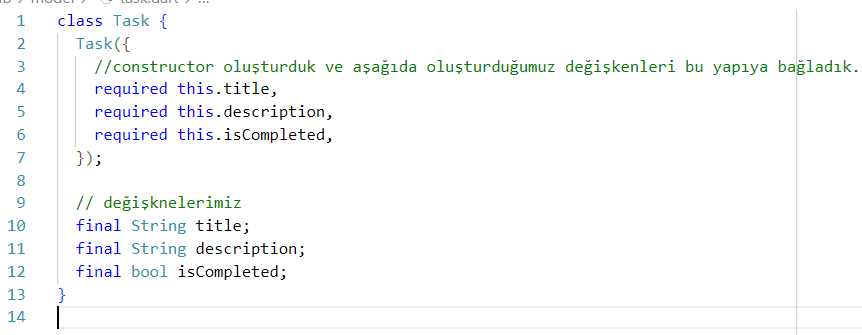 | 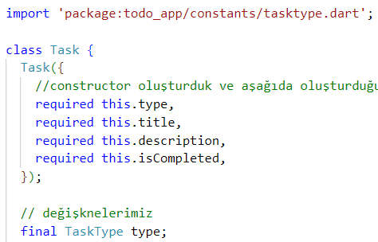 |

### 7.2 `lib/constants/tasktype.dart`

```dart
enum TaskType { note, calendar, contest }
```

> **Enum:** Sınırlı sayıda sabit değeri olan tür. Örn. `enum WeatherCondition { sunny, cloudy, rainy, snowy }`. Kullanımı: `TaskType.note`

### 7.3 `lib/model/task.dart`

```dart
class Task {
  Task({
    required this.type,           // constructor → aşağıdaki değişkenlere bağlanır
    required this.title,
    required this.description,
    required this.isCompleted,
  });

  final TaskType type;
  final String title;
  final String description;
  final bool isCompleted;
}
```

### 7.4 `List<Task>` oluşturma (home.dart)

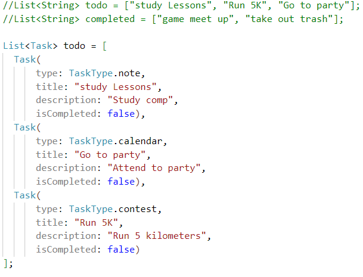

```dart
List<Task> todo = [
  Task(type: TaskType.note,     title: "Study Lessons", description: "Study comp",       isCompleted: false),
  Task(type: TaskType.calendar, title: "Go to party",   description: "Attend to party",  isCompleted: false),
  Task(type: TaskType.contest,  title: "Run 5K",        description: "Run 5 kilometers", isCompleted: false),
];
```

### 7.5 Modeli custom widget'a aktarma

```dart
// home.dart
itemBuilder: (context, index) {
  return TodoItem(task: todo[index]);         // String değil, Task nesnesi gönderiliyor
},

// todoitem.dart
class TodoItem extends StatefulWidget {
  const TodoItem({super.key, required this.task});
  final Task task;
  @override
  State<TodoItem> createState() => _TodoItemState();
}

class _TodoItemState extends State<TodoItem> {
  bool isChecked = false;

  @override
  Widget build(BuildContext context) {
    return Card(
      child: Row(
        children: [
          Icon(widget.task.type == TaskType.note
              ? Icons.note_outlined
              : widget.task.type == TaskType.calendar
                  ? Icons.calendar_month
                  : Icons.emoji_events),              // tipe göre ikon
          Column(
            children: [
              Text(widget.task.title, style: const TextStyle(fontWeight: FontWeight.bold)),
              Text(widget.task.description),
            ],
          ),
          Checkbox(
            value: isChecked,
            onChanged: (val) => setState(() { isChecked = val!; }),
          ),
        ],
      ),
    );
  }
}
```

---

## 8 · Örnek Sınav Soruları (Problem → Kod)

> Sorular NotebookLM'e "bu kaynaklara göre sınavda çıkabilecek problemler" diye sorularak ve derste verilen **UYGULAMA** görevleri temel alınarak hazırlandı. Import yazmana gerek yok, widget isimleri doğru olsun yeter.

### Soru 1 — Navigator ile sayfa geçişi ve geri dönüş

> Ana sayfadaki bir `ElevatedButton`'a basıldığında `DetaySayfasi` adlı yeni ekran açılsın. Detay sayfasındaki çarpı (`IconButton`) ikonuna basınca önceki sayfaya dönülsün.

```dart
class AnaSayfa extends StatelessWidget {
  const AnaSayfa({super.key});

  @override
  Widget build(BuildContext context) {
    return Scaffold(
      appBar: AppBar(title: const Text("Ana Sayfa")),
      body: Center(
        child: ElevatedButton(
          onPressed: () {
            Navigator.of(context).push(
              MaterialPageRoute(builder: (context) => const DetaySayfasi()),
            );
          },
          child: const Text("Detay Sayfasına Git"),
        ),
      ),
    );
  }
}

class DetaySayfasi extends StatelessWidget {
  const DetaySayfasi({super.key});

  @override
  Widget build(BuildContext context) {
    return Scaffold(
      body: Center(
        child: IconButton(
          icon: const Icon(Icons.close, size: 40),
          onPressed: () {
            Navigator.of(context).pop();
          },
        ),
      ),
    );
  }
}
```

### Soru 2 — Custom widget'a parametre aktarma

> Ders isimlerini kart olarak gösteren `DersKarti` adlı bir custom widget yazın. `dersAdi` parametresini zorunlu alsın. Ana ekranda `["Mobil Programlama", "Veritabanı", "Ağlar"]` listesini `ListView.builder` ile `DersKarti` kullanarak gösterin.

```dart
class DersKarti extends StatefulWidget {
  const DersKarti({super.key, required this.dersAdi});
  final String dersAdi;

  @override
  State<DersKarti> createState() => _DersKartiState();
}

class _DersKartiState extends State<DersKarti> {
  @override
  Widget build(BuildContext context) {
    return Card(
      shape: RoundedRectangleBorder(borderRadius: BorderRadius.circular(20)),
      child: Padding(
        padding: const EdgeInsets.all(20),
        child: Row(
          children: [
            const Icon(Icons.book, size: 40),
            Text(widget.dersAdi, style: const TextStyle(fontWeight: FontWeight.bold, fontSize: 20)),
          ],
        ),
      ),
    );
  }
}

class DersListesi extends StatelessWidget {
  DersListesi({super.key});
  final List<String> dersler = ["Mobil Programlama", "Veritabanı", "Ağlar"];

  @override
  Widget build(BuildContext context) {
    return MaterialApp(
      home: Scaffold(
        appBar: AppBar(title: const Text("Derslerim"), centerTitle: true),
        body: ListView.builder(
          itemCount: dersler.length,
          itemBuilder: (context, index) {
            return DersKarti(dersAdi: dersler[index]);
          },
        ),
      ),
    );
  }
}
```

### Soru 3 — Model + Enum + Liste

> `TaskType` enum'u (note, calendar, contest) ve `Task` model sınıfı (type, title, description, isCompleted) tanımlayın. Bir `List<Task>` oluşturup `ListView.builder` ile başlık ve açıklamalarını listeleyin.

```dart
enum TaskType { note, calendar, contest }

class Task {
  Task({required this.type, required this.title, required this.description, required this.isCompleted});
  final TaskType type;
  final String title;
  final String description;
  final bool isCompleted;
}

class TaskListScreen extends StatefulWidget {
  const TaskListScreen({super.key});
  @override
  State<TaskListScreen> createState() => _TaskListScreenState();
}

class _TaskListScreenState extends State<TaskListScreen> {
  List<Task> todo = [
    Task(type: TaskType.note,    title: "Study Lessons", description: "Comp exam",   isCompleted: false),
    Task(type: TaskType.contest, title: "Run 5K",        description: "Morning run", isCompleted: false),
  ];

  @override
  Widget build(BuildContext context) {
    return Scaffold(
      body: SingleChildScrollView(
        child: ListView.builder(
          primary: false,
          shrinkWrap: true,
          itemCount: todo.length,
          itemBuilder: (context, index) {
            return Card(
              child: Column(
                children: [
                  Text(todo[index].title),
                  Text(todo[index].description),
                ],
              ),
            );
          },
        ),
      ),
    );
  }
}
```

### Soru 4 — setState ile iki sayının toplamı (derste verilen UYGULAMA)

> İki integer değişken tanımlayın. Ekrana satır satır önce değişkenleri, butona basıldığında da toplamı yazdırın.

```dart
class Test extends StatefulWidget {
  const Test({super.key});
  @override
  State<Test> createState() => _TestState();
}

class _TestState extends State<Test> {
  int top = 0;
  int val1 = 7;
  int val2 = 5;

  @override
  Widget build(BuildContext context) {
    return MaterialApp(
      home: Scaffold(
        body: Center(
          child: Column(
            mainAxisAlignment: MainAxisAlignment.center,
            children: [
              Text("val1 = $val1"),
              Text("val2 = $val2"),
              Text(top.toString()),
              ElevatedButton(
                onPressed: () {
                  setState(() {
                    top = val1 + val2;
                  });
                },
                child: const Text("tıklayın"),
              ),
            ],
          ),
        ),
      ),
    );
  }
}
```

### Soru 5 — Checkbox ile görev tamamlama

> Bir Card içinde görev adı ve Checkbox olsun. Checkbox'a tıklanınca işaretlensin.

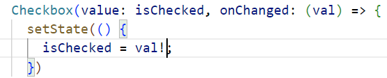

```dart
class GorevKarti extends StatefulWidget {
  const GorevKarti({super.key});
  @override
  State<GorevKarti> createState() => _GorevKartiState();
}

class _GorevKartiState extends State<GorevKarti> {
  bool isChecked = false;          // ⚠️ build'in DIŞINDA

  @override
  Widget build(BuildContext context) {
    return Card(
      child: Row(
        children: [
          const Text("Görevi Tamamla"),
          Checkbox(
            value: isChecked,
            onChanged: (val) {
              setState(() {
                isChecked = val!;
              });
            },
          ),
        ],
      ),
    );
  }
}
```

### Soru 6 — Müşteri (Customer) listesi: Model + Custom Widget + Navigator

> **Tüm sınav konularını birleştiren soru.** `Customer` modeli (ad, telefon, şehir) oluşturun. Müşterileri `ListView.builder` ve `CustomerCard` custom widget'ı ile listeleyin. Bir karta tıklanınca `CustomerDetail` sayfası açılsın ve müşterinin bilgileri gösterilsin.

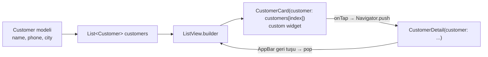

```dart
// 1) MODEL
class Customer {
  Customer({required this.name, required this.phone, required this.city});
  final String name;
  final String phone;
  final String city;
}

// 2) ANA SAYFA (liste)
class CustomerListScreen extends StatelessWidget {
  CustomerListScreen({super.key});

  final List<Customer> customers = [
    Customer(name: "Ali Yılmaz", phone: "0555 111 22 33", city: "Aksaray"),
    Customer(name: "Ayşe Demir", phone: "0555 444 55 66", city: "Ankara"),
    Customer(name: "Mehmet Kaya", phone: "0555 777 88 99", city: "Konya"),
  ];

  @override
  Widget build(BuildContext context) {
    return Scaffold(
      appBar: AppBar(title: const Text("Müşteriler"), centerTitle: true),
      body: ListView.builder(
        itemCount: customers.length,
        itemBuilder: (context, index) {
          return CustomerCard(customer: customers[index]);
        },
      ),
    );
  }
}

// 3) CUSTOM WIDGET
class CustomerCard extends StatelessWidget {
  const CustomerCard({super.key, required this.customer});
  final Customer customer;

  @override
  Widget build(BuildContext context) {
    return GestureDetector(
      onTap: () {
        Navigator.of(context).push(
          MaterialPageRoute(builder: (context) => CustomerDetail(customer: customer)),
        );
      },
      child: Card(
        child: Padding(
          padding: const EdgeInsets.all(20),
          child: Row(
            children: [
              const Icon(Icons.person, size: 40),
              Text(customer.name, style: const TextStyle(fontSize: 20, fontWeight: FontWeight.bold)),
            ],
          ),
        ),
      ),
    );
  }
}

// 4) DETAY SAYFASI
class CustomerDetail extends StatelessWidget {
  const CustomerDetail({super.key, required this.customer});
  final Customer customer;

  @override
  Widget build(BuildContext context) {
    return Scaffold(
      appBar: AppBar(title: Text(customer.name)),    // geri tuşu otomatik gelir
      body: Center(
        child: Column(
          mainAxisAlignment: MainAxisAlignment.center,
          children: [
            Text("Ad: ${customer.name}"),
            Text("Telefon: ${customer.phone}"),
            Text("Şehir: ${customer.city}"),
            ElevatedButton(
              onPressed: () => Navigator.of(context).pop(),
              child: const Text("Geri"),
            ),
          ],
        ),
      ),
    );
  }
}

// 5) main
void main() => runApp(MaterialApp(home: CustomerListScreen()));
```

### Soru 7 — Derste verilen diğer UYGULAMA görevleri (kısa çözümler)

<details>
<summary><b>7a) Merhaba Dünya: ortalı başlık, solda "Menu", renkli AppBar, ortada 3 satır bilgi</b></summary>

```dart
MaterialApp(
  home: Scaffold(
    appBar: AppBar(
      title: const Text("Merhaba"),
      centerTitle: true,
      backgroundColor: Colors.deepOrange,
      leading: const Text("Menu"),
    ),
    body: const Center(
      child: Column(
        mainAxisAlignment: MainAxisAlignment.center,
        children: [
          Text('Hasan DEMİR'),
          Text('2024236'),
          Text('Yazılım Mühendisliği'),
        ],
      ),
    ),
  ),
)
```
</details>

<details>
<summary><b>7b) GoogleFonts + HexColor: başlık, ortada Roboto 40 ile ad, başka fontla ders adı, renk #00913A</b></summary>

```dart
MaterialApp(
  theme: ThemeData(textTheme: GoogleFonts.robotoTextTheme()),   // tüm proje roboto
  home: Scaffold(
    appBar: AppBar(title: const Text("Flutter googlefonts ve hexcolor uygulaması"), centerTitle: true),
    body: Center(
      child: Column(
        mainAxisAlignment: MainAxisAlignment.center,
        children: [
          Text("Hasan Demir", style: GoogleFonts.roboto(fontSize: 40, color: HexColor("00913A"))),
          Text("Mobil programlama", style: GoogleFonts.acme(fontSize: 40, color: HexColor("00913A"))),
        ],
      ),
    ),
  ),
)
```
</details>

<details>
<summary><b>7c) Row ile ad, bölüm, numara — her kenardan 20 boşluk, dikeyde ortalı</b></summary>

```dart
Scaffold(
  body: Padding(
    padding: const EdgeInsets.all(20),
    child: Row(
      mainAxisAlignment: MainAxisAlignment.spaceBetween,
      crossAxisAlignment: CrossAxisAlignment.center,   // Row'da dikey eksen = cross axis
      children: const [
        Text("Hasan DEMİR"),
        Text("Yazılım Müh."),
        Text("2024236"),
      ],
    ),
  ),
)
```
</details>

<details>
<summary><b>7d) Container içinde assets'ten resim + ortalı AppBar başlığı</b></summary>

```dart
// pubspec.yaml →  assets:  - lib/assets/images/
Scaffold(
  appBar: AppBar(title: const Text("Resim Uygulaması"), centerTitle: true),
  body: Container(
    padding: const EdgeInsets.all(20),
    child: Image.asset("lib/assets/images/img1.jpg"),
  ),
)
```
</details>

---

## 9 · Kod Çıktısı Soruları (ekranda ne görünür?)

| # | Kod | Çıktı / Açıklama |
|---|---|---|
| 1 | `home: Container(color: Colors.red, width: 100, height: 100)` | **Tüm ekran kırmızı.** Üstte boyut kısıtı veren widget yok → width/height etkisiz. |
| 2 | `home: Center(child: Container(color: Colors.red, width: 100, height: 100))` | **Ortada 100×100 kırmızı kare.** Center serbestlik verir. |
| 3 | `Center(child: Container(color: Colors.red, child: Container()))` | Boyutsuz Container çocuğu kadar küçülür → neredeyse **görünmez**. |
| 4 | `Center(child: Container(color: Colors.red, width: 200, height: 200, child: Container(color: Colors.green)))` | **200×200 yeşil kare** (yeşil, kırmızının tamamını kaplar). |
| 5 | `Center(child: Align(alignment: Alignment.bottomCenter, child: Container(...100x100)))` | Kare **ekranın alt ortasında**. |
| 6 | `Row(children: [Container(child: Text("çok uzun metin...")), ...])` | **Overflow** (sarı-siyah şerit). Çözüm: `Expanded`. |
| 7 | `onPressed: () { val = val + 1; }` (setState yok) | Ekranda sayı **değişmez**, sadece değişken artar. |
| 8 | `bool isChecked = false;` **build içinde** + `setState` | Checkbox **hiç işaretlenmez**; her build'de tekrar false olur. |
| 9 | `Text(val)` (val int) | **Hata.** Text String ister → `Text(val.toString())` veya `Text("$val")`. |
| 10 | `SingleChildScrollView(child: ListView.builder(...))` (shrinkWrap yok) | **Hata** (unbounded height). Çözüm: `shrinkWrap: true, primary: false`. |
| 11 | `Navigator.of(context).pop()` ilk sayfada | Yığında önceki sayfa yok → siyah ekran / uygulamadan çıkar. |
| 12 | `Text("val1 = $val1")` (val1 = 7) | `val1 = 7` |

---

## 10 · Sık Yapılan Hatalar

| Hata | Neden? | Doğrusu |
|---|---|---|
| 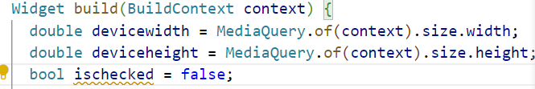 | `setState` → `build` tekrar çalışır → `isChecked` tekrar `false` olur | 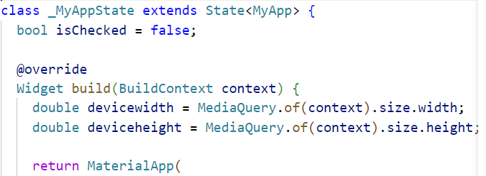 |
| `isChecked = val;` | `onChanged`'deki `val` tipi `bool?` (null olabilir) | `isChecked = val!;` |
| `ListView.builder` içinde `SingleChildScrollView` → hata | İkisi de kaydırılabilir, ikisi de sonsuz alan istiyor | `shrinkWrap: true` + `primary: false` |
| Row'da taşma (overflow) | Çocuklar ekran genişliğini aşıyor | `Expanded` / `Flexible` ile sar |
| Stateful widget'ta `title` kullanmak | Parametre Widget sınıfında, kod State sınıfında | `widget.title` |
| StatelessWidget içinde `setState` | Stateless'ın state'i yok | Ctrl+Shift+R → *Convert to StatefulWidget* |
| Container'da hem `color` hem `decoration` | İkisi aynı anda verilemez | Rengi `BoxDecoration(color: ...)` içine yaz |
| pubspec.yaml'da yanlış girinti | YAML boşluklara duyarlı | `assets:` → `- lib/assets/images/` hizalamasına dikkat |
| Klavye açılınca overflow | Ekran içeriği sığmıyor | Gövdeyi `SingleChildScrollView` içine al |
| `MaterialPageRoute(builder: ...)` yerine doğrudan widget vermek | `push` bir **Route** ister | `push(MaterialPageRoute(builder: (context) => Sayfa()))` |

---

## 11 · Test Soruları İçin Hızlı Tekrar

1. **StatelessWidget nedir?** → Durumu değişmeyen, bir kez oluşturulduktan sonra sabit kalan widget.
2. **StatefulWidget kaç sınıftan oluşur?** → 2: Widget sınıfı + `State` sınıfı (`createState()` ile bağlanır).
3. **`setState()` ne yapar?** → Durumu günceller ve widget'ı **yeniden build** eder.
4. **`Navigator.push` ne yapar?** → Navigation stack'in **en üstüne** yeni sayfa ekler.
5. **`Navigator.pop` ne yapar?** → En üstteki sayfayı yığından **çıkarır**, önceki sayfaya döner.
6. **AppBar'lı sayfaya push yapınca ne olur?** → Sol üstte **otomatik geri tuşu** çıkar.
7. **Row'da main axis?** → **Yatay**. Cross axis → dikey. (Column'da tam tersi.)
8. **Padding ile Margin farkı?** → Padding **iç** boşluk, margin **dış** boşluk.
9. **`Expanded` ne işe yarar?** → Row/Column'daki kalan alanı kaplar, overflow'u önler.
10. **`SafeArea`?** → İçeriğin bildirim çubuğu/alt tuşlar altına taşmasını önler.
11. **`MediaQuery.of(context).size.width`?** → Ekran genişliği (double).
12. **`ListView.builder`'ın zorunlu parametreleri?** → `itemBuilder` (+ genelde `itemCount`).
13. **`shrinkWrap: true`?** → Liste sadece içeriği kadar alan kaplar.
14. **`primary: false`?** → Ana kaydırmayı dıştaki scroll widget'ına bırakır.
15. **`GestureDetector`?** → Dokunma olaylarını yakalar (`onTap`, `onDoubleTap`, `onLongPress`…).
16. **SnackBar nasıl gösterilir?** → `ScaffoldMessenger.of(context).showSnackBar(SnackBar(content: Text("..."), duration: Duration(milliseconds: 300)))`
17. **Enum nedir?** → Sınırlı sayıda sabit değer grubu: `enum TaskType { note, calendar, contest }`.
18. **Model sınıfı neden kullanılır?** → İlgili verileri (title, description, isCompleted, type) **tek nesnede** toplamak; `List<String>` → `List<Task>`.
19. **Custom widget neden kullanılır?** → **Tekrar eden kodu** tek yerde toplamak, parametre ile dinamik hale getirmek.
20. **`final` neden?** → Widget'a gelen veri sınıf içinde değişmesin, sadece gösterilsin.
21. **`required`?** → Constructor parametresi zorunlu.
22. **Paket nasıl eklenir?** → `flutter pub add hexcolor` veya pubspec.yaml `dependencies:` altına.
23. **Debug bandını kaldırmak?** → `debugShowCheckedModeBanner: false`.
24. **Constraints kuralı?** → Constraints go down, sizes go up, parent sets position.

---

## 12 · Son Dakika Kopya Kağıdı

```dart
// ───────── STATEFUL İSKELET ─────────
class Sayfa extends StatefulWidget {
  const Sayfa({super.key});
  @override
  State<Sayfa> createState() => _SayfaState();
}
class _SayfaState extends State<Sayfa> {
  int sayac = 0;                                    // state build DIŞINDA
  @override
  Widget build(BuildContext context) {
    return Scaffold(
      appBar: AppBar(title: const Text("Başlık"), centerTitle: true),
      body: Center(child: Text("$sayac")),
      floatingActionButton: FloatingActionButton(
        onPressed: () => setState(() { sayac++; }),
        child: const Icon(Icons.add),
      ),
    );
  }
}

// ───────── NAVIGATOR ─────────
Navigator.of(context).push(MaterialPageRoute(builder: (context) => const YeniSayfa()));
Navigator.of(context).pop();

// ───────── MODEL ─────────
enum TaskType { note, calendar, contest }
class Task {
  Task({required this.type, required this.title, required this.description, required this.isCompleted});
  final TaskType type;
  final String title;
  final String description;
  final bool isCompleted;
}
List<Task> todo = [Task(type: TaskType.note, title: "Study", description: "...", isCompleted: false)];

// ───────── CUSTOM WIDGET ─────────
class TodoItem extends StatefulWidget {
  const TodoItem({super.key, required this.task});
  final Task task;
  @override
  State<TodoItem> createState() => _TodoItemState();
}
class _TodoItemState extends State<TodoItem> {
  bool isChecked = false;
  @override
  Widget build(BuildContext context) => Card(
    child: Row(children: [
      Text(widget.task.title),                     // widget. ile eriş
      Checkbox(value: isChecked, onChanged: (val) => setState(() { isChecked = val!; })),
    ]),
  );
}

// ───────── LISTE ─────────
ListView.builder(
  shrinkWrap: true, primary: false,
  itemCount: todo.length,
  itemBuilder: (context, index) => TodoItem(task: todo[index]),
)

// ───────── DİĞER ─────────
MediaQuery.of(context).size.width / .height
SafeArea(child: Scaffold(...))
Container(decoration: BoxDecoration(image: DecorationImage(image: AssetImage("..."), fit: BoxFit.cover)))
GestureDetector(onTap: () {...}, child: ...)
ScaffoldMessenger.of(context).showSnackBar(const SnackBar(content: Text("Mesaj")));
TextField(decoration: InputDecoration(filled: true, fillColor: Colors.white))
Card(shape: RoundedRectangleBorder(borderRadius: BorderRadius.circular(20)))
```

---

<sub>📌 Kaynak: Mobil Programlama ders sunumları (2_2, 3_1, 4_1, 5_1, 6_1yeni, 7_1) + NotebookLM "flutter sınav" defteri. Görseller sunumlardaki ekran görüntüleridir. Başarılar! 🍀</sub>
